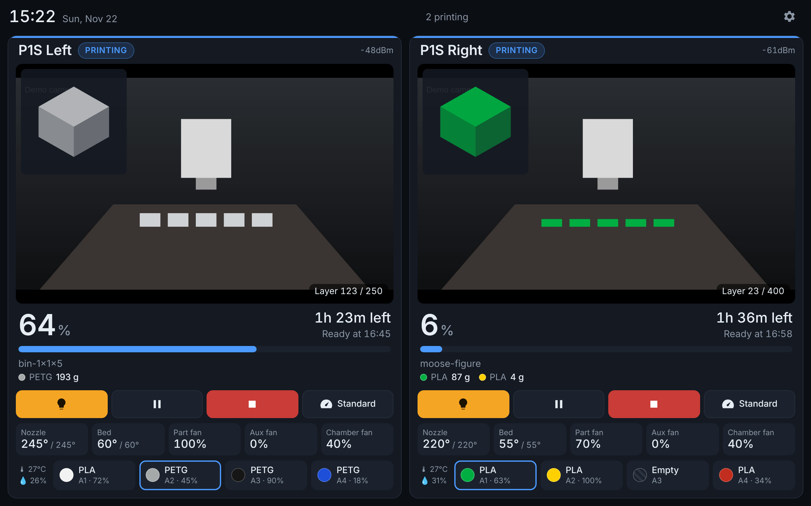

# PrintWatch

A full-screen dashboard for Bambu Lab printers (built for two P1S printers) that turns an
Android tablet into a dedicated printer monitor and control panel.

It is completely self-contained: the app talks **directly to your printers over your own
network**. There is no server, no Home Assistant, no kiosk browser and no Bambu cloud in between.



## What it shows and does

- **Live camera** of each printer (tap it for full screen)
- **Model preview** of what is printing, plus the **filament the job uses** (type, colour, grams)
- **Progress**, layer *x / y*, time left and the **clock time it will be ready**
- Nozzle and bed temperature, part / aux / chamber fan speeds, speed mode
- **AMS**: every slot's colour, material and remaining %, the active slot highlighted,
  AMS temperature and humidity
- Errors and HMS warnings, and the reason for a pause (e.g. filament runout)
- **Controls**: chamber light, pause / resume, stop (with confirmation), speed mode
  (Silent / Standard / Sport / Ludicrous), set nozzle and bed temperature, set fan speeds
- Plays a sound when a print finishes, fails or pauses
- Dims the screen when nothing is printing; the first tap only wakes it up
- Starts straight into the dashboard when the tablet boots (it acts as the tablet's home screen)

## Install on the tablet

1. Download `PrintWatch.apk` from the [Releases page](../../releases) on the tablet.
2. Open it. Android asks to allow installing from this source: allow it, then install.
3. Open **PrintWatch**. The settings screen appears: enter each printer's
   **name, IP address, serial number and access code** and tap **Save**.
4. **Make it the home screen**, so the tablet boots into it and the Home button always returns to it:
   press the tablet's **Home** button, choose **PrintWatch**, and tap **Always**.
   (Or: Android Settings → Apps → Default apps → Home app → PrintWatch.)

Tips for a wall-mounted tablet:
- Android Settings → Display → Screen timeout doesn't matter: PrintWatch keeps the screen on itself.
- Remove the lock screen (Settings → Security → Screen lock → None), so it boots straight in.
- Keep the tablet on a charger. Many tablets have a "protect battery / limit to 85%" option: turn it on.

**Getting out again:** tap the gear (top right) → *Change home app* or *Android settings*.

## Where to find the printer details

On the printer's screen:
- **Settings → WLAN**: *IP* and *Access Code*
- **Settings → Device**: *Printer* = the serial number (starts with `01P…`)

Give each printer a fixed IP address (a "DHCP reservation") in your router, so the address
never changes.

### LAN Only Mode and Developer Mode

PrintWatch uses the printer's local network connection (the same one Bambu Studio uses in LAN mode).

- **Viewing status and camera** normally works with LAN Only Mode on or off.
  If a printer stays *Offline* with LAN Only Mode **off**, switch it **on**.
- **Controls** (pause, stop, light, temperatures…): recent Bambu firmware only accepts commands
  from third-party apps when **LAN Only Mode** *and* **Developer Mode** are switched on in the
  printer's settings. Developer Mode disconnects the printer from the Bambu cloud and the
  Bambu Handy app; Bambu Studio / OrcaSlicer in LAN mode keep working.

## How it works

| Port | Protocol | Used for |
|------|----------|----------|
| 8883 | MQTT over TLS (user `bblp`, password = access code) | live status and commands |
| 6000 | TLS JPEG stream | the chamber camera (P1 / A1 series) |
| 990  | implicit FTPS | downloads the job's `.3mf` once per print for the preview image and filament usage |

The code is small and has no third-party libraries:

- `app/src/main/java/dev/printwatch/`
  - `MiniMqtt.java`: a minimal MQTT 3.1.1 client
  - `PrinterConnection.java`: one printer: status, commands, camera, auto-reconnect
  - `ModelFetcher.java` + `TlsInputStream.java`: FTPS download and 3MF parsing
  - `MainActivity.java`: full-screen home-screen activity hosting the dashboard
- `app/src/main/assets/web/`: the dashboard itself (HTML / CSS / JavaScript).
  Open `index.html` in a desktop browser to see it with demo data, handy for tweaking the look.

## Building

GitHub builds the APK automatically on every push (Actions tab → latest run → *PrintWatch-apk*).
Pushing a tag like `v1.0.1` publishes it as a release.

To build yourself, install Android Studio (or the Android SDK + JDK 17) and run:

```bash
./gradlew assembleRelease
```

The APK lands in `app/build/outputs/apk/release/app-release.apk`. The project includes its own
signing key (`keystore/`), so every build can update the installed app without uninstalling.

## Testing without a printer

`tools/fake_printer.py` pretends to be a P1S (MQTT, camera and FTPS, all over TLS):

```bash
openssl req -x509 -newkey rsa:2048 -nodes -keyout key.pem -out cert.pem -days 365 -subj "/CN=fake"
```

```bash
python3 tools/fake_printer.py --cert cert.pem --key key.pem --host 0.0.0.0
```

Then add a printer in PrintWatch with your computer's IP, serial `01P00A000000001` and access code `12345678`.
