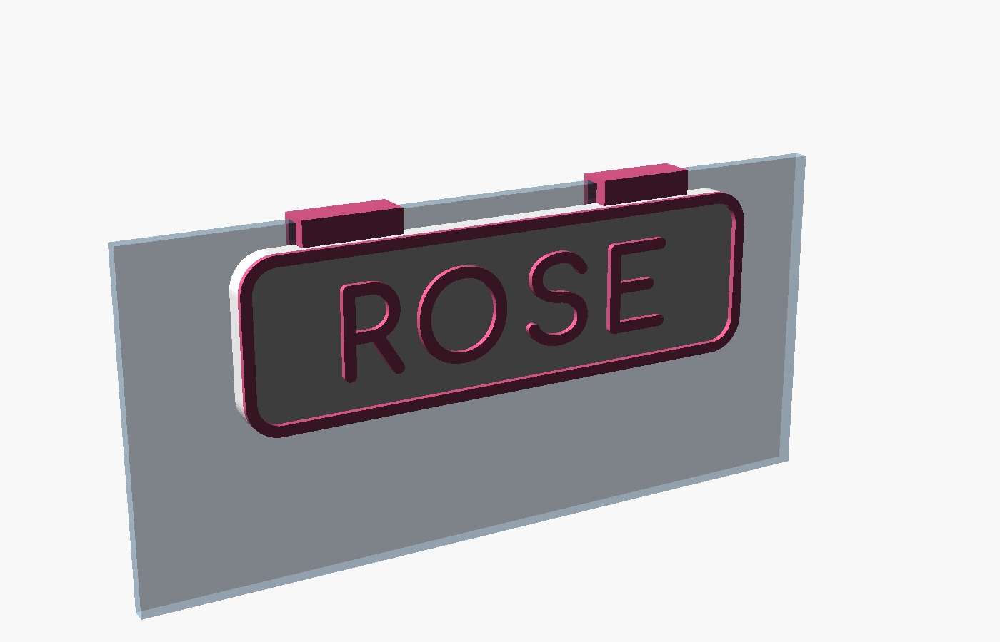

# Printer nameplates



Two-colour nameplates (ROSE, LUCA) that hang on the top edge of the P1S glass door: no tape, no tools.

| File | Print | How |
|------|-------|-----|
| `rose-base.stl` + `rose-top.stl` | 1 | flat, two colours: plate (base) and rim + letters (top) |
| `luca-base.stl` + `luca-top.stl` | 1 | same |
| `hook.stl` | 4 (2 per plate) | lying flat exactly as exported |
| `glass-gauge.stl` | only if needed | test comb, see below |

**Two colours in Bambu Studio:** load `rose-base.stl` and `rose-top.stl` together and answer **Yes**
when it asks to load them as one object with multiple parts. Then give each part its own filament.

**Fitting:** slide the hooks into the two slots at the top of the back of the plate, then hang the
hooks over the top edge of the door glass. The plate hangs on the outside of the door.

**Sizes:** the P1S door glass measures 2.97 mm. The hooks have a 3.2 mm slot that narrows to 3.0 mm at a
small grip bump, only 1.0 mm of material over the top edge (so the door still closes) and a 1.5 mm leg
on the inside, the same as a clip known to fit the P1S door.
Print one hook first and try it on the door. If it is loose or too tight, print the gauge, find the
slot that slides snugly onto the glass, set `glass` in `nameplate.scad` to that size and export
the hook again:

```bash
openscad -D 'part="hook"' -D 'glass=3.4' -o hook.stl nameplate.scad
```

Other names: `openscad -D 'name="MAX"' -D 'part="base"' -o max-base.stl nameplate.scad` (and `part="top"`).
